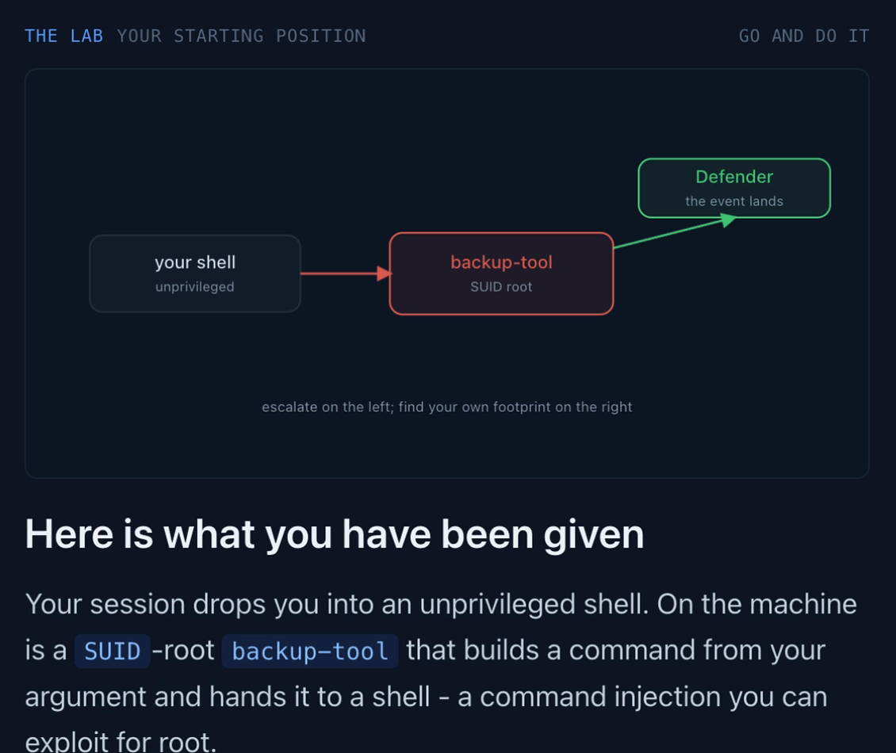
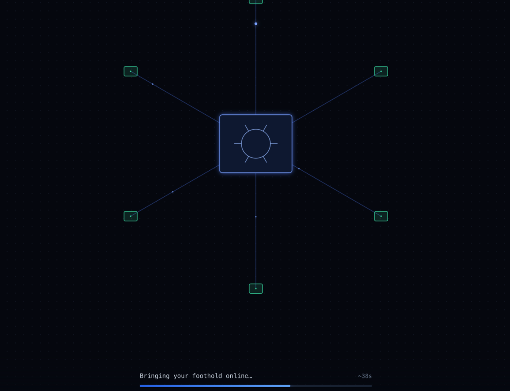
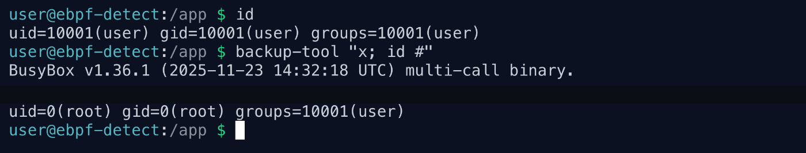
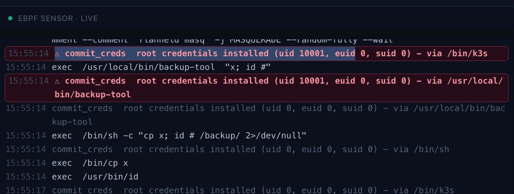
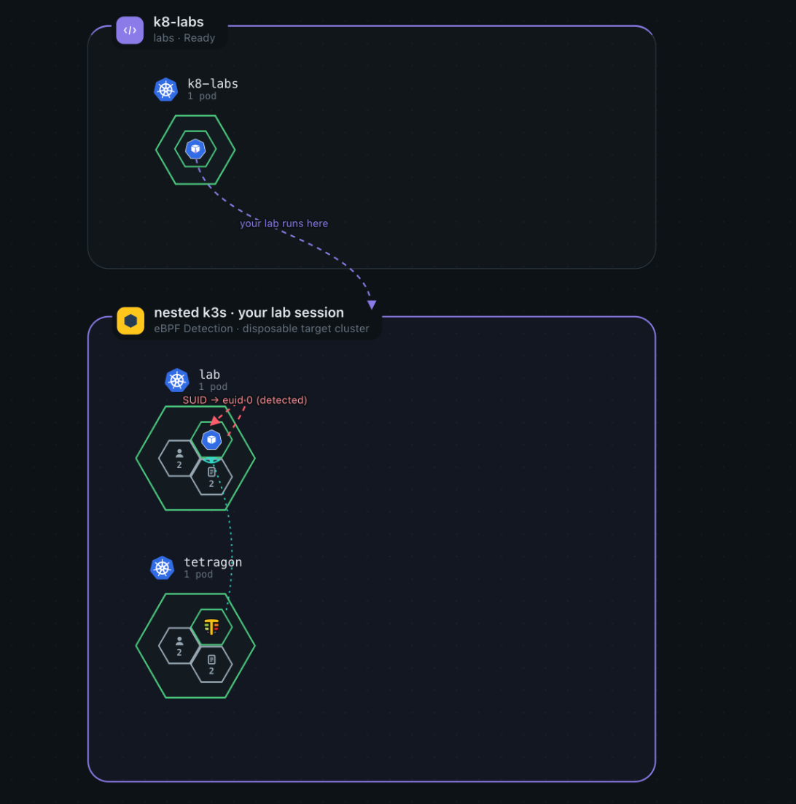

<h1 align="center">K8 Labs</h1>

<p align="center">
  <b>Hands-on Kubernetes attack &amp; defense.</b><br/>
  <em>Break into a disposable cluster, escalate to root, and watch an eBPF sensor catch you do it.</em>
</p>

https://github.com/user-attachments/assets/f283825d-731a-4d13-a253-1578f2176e5d

<p align="center">
  
  
  
  
  
  <a href="https://x.com/audit_wizard/status/2089453014138360243"></a>
  <a href="https://x.com/audit_wizard/status/2089453014138360243"></a>
</p>

<p align="center">
  <b>Isolated</b> · microVM + nested k3s &nbsp;·&nbsp; <b>Observed</b> · live eBPF &nbsp;·&nbsp; <b>Guided</b> · 20 CTF labs &nbsp;·&nbsp; <b>Self-hosted</b> · one box
</p>

<br/>

<h2 align="center">What's inside</h2>

<p align="center">
K8 Labs is a self-hosted platform for practicing <b>Kubernetes and container security</b> -<br/>
the offensive and defensive skills that come up in cloud-security and SRE interviews.<br/><br/>
Pick a lab and the backend boots a <b>disposable cluster just for that session</b>: a nested k3s inside a<br/>
Kata/Firecracker microVM, with a browser terminal, a root shell, and a target to break. You capture a flag,<br/>
you get a verifiable rank, and you tear the whole cluster down with one click.
</p>

<p align="center">
  <br/>
  <sub>Every lab is a guided course: a diagram of the attack, step-by-step instructions, and - on eBPF labs - a live Defender pane.</sub>
</p>

<br/>

<h2 align="center">How a session works</h2>

<p align="center">
Every session gets its own nested cluster with the vulnerability planted into it. Winning only ever<br/>
compromises a throwaway cluster inside a microVM - never the host, never another tenant.
</p>

<p align="center">
  <br/>
  <sub><b>1. Boot</b> - a disposable, airgapped microVM spins up in seconds</sub>
</p>

<p align="center">
  <br/>
  <sub><b>2. Exploit</b> - an unprivileged shell, a SUID command injection, and you are <code>uid=0(root)</code></sub>
</p>

<p align="center">
  <br/>
  <sub><b>3. Detect</b> - the eBPF/Tetragon sensor catches <code>commit_creds</code> at the kernel, the instant you escalate</sub>
</p>

<p align="center">
  <br/>
  <sub><b>4. Isolate</b> - your escape only ever touches a throwaway nested cluster inside the microVM</sub>
</p>

<br/>

<p align="center"><b>Under the hood:</b></p>

1. The browser asks the backend for a session; it returns immediately and provisions in the background.
2. The backend uses `client-go` to launch a session-runner pod. A config field picks the runtime: plain `runc` locally, a **Kata/Firecracker microVM** in production.
3. The runner boots a **disposable single-node k3s inside the pod/microVM**. Images come from baked airgap tarballs, so the nested cluster pulls nothing.
4. The backend applies the lab's **manifest bundle** into the nested cluster - the vulnerable namespaces, service accounts, roles, and the planted flag.
5. The frontend opens a **terminal** (xterm over WebSocket), a **topology map** of the target, and - on eBPF labs - a **Defender** pane streaming the in-guest Tetragon sensor.
6. One `DELETE` collapses the entire nested cluster. Sessions also expire on a timer.

<p align="center">
<b>Three walls.</b> The microVM is the kernel wall (contains a host/container escape). The nested k3s is the<br/>
API wall (contains an RBAC/namespace escape). A default-deny NetworkPolicy on the runner pod is the network wall.<br/>
See <a href="docs/architecture/">docs/architecture/</a> for the full write-up and diagrams.
</p>

<br/>

<h2 align="center">Lab catalog</h2>

<p align="center">
20 labs across 7 tracks. Labs marked <b>eBPF</b> add a live Tetragon sensor and a Defender pane;<br/>
<b>kernel</b> labs boot a KASAN-instrumented research kernel. Each is a capture-the-flag exercise with a guided course.
</p>

**First Flight**
| Lab | What you do |
|-----|-------------|
| Namespace Escape | A dev service account was granted Secret read too broadly via a `ClusterRoleBinding`. Read a Secret in the `production` namespace you were never meant to reach. |
| SUID Privilege Escalation | A root-owned SUID `backup-tool` hands your argument to a shell unsanitized. Exploit the command injection for a root shell. |
| eBPF Detection `eBPF` | Escalate via the SUID binary, then read the alert off an in-lab Tetragon sensor that catches the kernel installing root credentials. |
| Service Account Impersonation | Your account can impersonate identities but read nothing itself. Borrow `system:masters` to read the production Secret. |

**Recon**
| Lab | What you do |
|-----|-------------|
| First Contact | Pure local recon. Before you touch the network, find the secret the app leaked into the pod's own environment. |
| Who Am I | No `kubectl`, just a token and `curl`. Ask the API who you are and follow the one grant you were quietly given. |
| The Neighborhood | The API tells you nothing, but DNS never checks permissions. Map the cluster from what the pod already knows and reach an internal service. |

**Privilege Escalation**
| Lab | What you do |
|-----|-------------|
| Pod Creation Escalation | You can `create pods` but read nothing. Launch a pod that runs as a powerful build account and have it hand you the flag. |
| RoleBinding Self-Grant | You can create RoleBindings. Find the one verb that defeats Kubernetes' escalation check, grant yourself Secret access, and read the flag. |

**Lateral Movement**
| Lab | What you do |
|-----|-------------|
| Image Pull Secret Theft | A harmless-looking Secret-read grant exposes the cluster's `imagePullSecret`. Harvest it and recover the registry credentials. |
| Pod Exec Lateral Movement | You can `exec` into pods in `ops`. Drop into a CI pod and use its mounted token to read a production Secret. |
| Node Token Harvest `eBPF` | With node filesystem access, harvest another pod's kubelet-written token to pivot - while the sensor catches you reading it off the node. |
| Egress Beacon Detection `eBPF` | Beacon to a collector on the C2 port. Tetragon hooks `tcp_connect` and logs the connection at the socket the instant you make it. |

**Node Escape**
| Lab | What you do |
|-----|-------------|
| hostPath Node Escape | A careless `hostPath` mount of the node root dissolves the container boundary. Read a root-owned file on the node itself. |
| Privileged Pod Breakout `eBPF` | A privileged, `hostPID` pod reaches the host via `/proc/1/root`. Break out, then watch the sensor catch the dereference. |

**Persistence**
| Lab | What you do |
|-----|-------------|
| Sidecar Injection | Patch a Deployment in `ops` to inject a container that inherits a powerful workload's token. |
| Static Pod Persistence | Write to the kubelet's static-pod directory. It runs your manifest with no API server, admission, or RBAC in the way. |
| Malicious Admission Webhook | Register a mutating webhook that injects a container into every `production` pod the API server admits. |

**Research** `kernel`
| Lab | What you do |
|-----|-------------|
| Kernel Driver Research - Dev | An on-demand kernel VM with KASAN + KCOV + BTF and a full toolchain, mitigations off. Build and `insmod` the sample vulnerable driver, trip it under KASAN, groom a slab reclaim to overwrite `cred`. |
| Kernel Driver Research - Hard | The same instrumented kernel with production mitigations (KASLR, hardened freelist, `RANDOM_KMALLOC_CACHES`, static usermodehelper). Cross-cache, KASLR leak, data-only `cred` overwrite. |

<br/>

<h2 align="center">Tech stack</h2>

| Layer | What it uses |
|-------|--------------|
| **Backend** | Go (stdlib `net/http` + `ServeMux`), `client-go`, `pgx` (raw SQL), `golang-jwt`, `log/slog`, Swagger via `swaggo` |
| **Frontend** | React 18, Vite 5, Bun, Tailwind + Radix, TanStack Query, `@xterm/xterm`; terminal over WebSocket, Defender over SSE |
| **Data** | PostgreSQL (users, progress, leaderboard, drivers) |
| **Lab runtime** | Nested **k3s** inside **Kata Containers + Firecracker** microVMs; a shared foothold image; airgapped image tarballs |
| **Sensor** | **Tetragon** (eBPF) for the Defender pane; KASAN + KCOV + BTF research guest kernels |
| **Platform** | Helm + **ArgoCD** (GitOps), **Cilium** (CNI + NetworkPolicy), cert-manager, HashiCorp Vault, Terraform (Hetzner), Grafana/Loki/Alloy |

<br/>

<h2 align="center">Run it locally</h2>

<p align="center"><b>Fast path</b> - API + Postgres, no cluster. Good for auth, the catalog, and the course UI.</p>

```bash
cp secrets/backend.env.local.example secrets/backend.env     # dummy values are fine
docker compose up                                            # backend + postgres (DEV_LOGIN=1)
cd services/frontend && bun install && bun run dev           # http://localhost:7373
```

<p align="center"><b>Full path</b> - Tilt + k3d, a real cluster with live session provisioning (sessions run under <code>runc</code> locally).</p>

```bash
tilt up
cd services/frontend && bun install && bun run dev
```

<p align="center">Full prerequisites and the exact k3d / Cilium / cert-manager bring-up are in <a href="docs/self-hosting.md">docs/self-hosting.md</a>.</p>

<br/>

<h2 align="center">Self-hosting</h2>

<p align="center">
K8 Labs runs on a small, cheap footprint. The reference deployment is a two-node <a href="https://www.hetzner.com/">Hetzner</a> setup<br/>
(a cloud VM for the control plane and app, a bare-metal box for the microVM lab node - nested virtualization needs real hardware),<br/>
with a budget single-box option that fits a ~$70/month budget. Full guide and Terraform: <a href="docs/self-hosting.md">docs/self-hosting.md</a>.
</p>

<br/>

<h2 align="center">Security</h2>

<p align="center">
A <b>live instance ran under a public bug bounty for a month</b>: a ~$1,000 (ETH) pot to escape a lab's microVM
to the underlying host, and <b>no one broke in</b> -
<a href="https://x.com/audit_wizard/status/2089453014138360243">read the announcement</a>.
</p>

<p align="center">
Every lab ships with <b>intentional vulnerabilities</b> - that is the point. They only ever run inside a disposable,<br/>
isolated nested cluster, and lab pods get no cluster credentials by construction. Do not deploy the lab manifests<br/>
into a cluster you care about. Found a problem in the platform itself? See <a href="SECURITY.md">SECURITY.md</a>.
</p>

<br/>

<h2 align="center">Contributions</h2>

<table align="center">
<tr>
    <td align="center">
        <a href="https://github.com/forefy">
            
            <br/><sub><b>forefy</b></sub>
        </a>
    </td>
</tr>
</table>

<p align="center">
PRs welcome - new labs (see <a href="services/labs/AUTHORING.md">AUTHORING.md</a> and <a href="CONTRIBUTING.md">CONTRIBUTING.md</a>),<br/>
fixes, and docs. A good lab teaches one specific misconfiguration or technique and ends in a captured flag.
</p>

<p align="center"><sub>MIT licensed · © forefy</sub></p>
