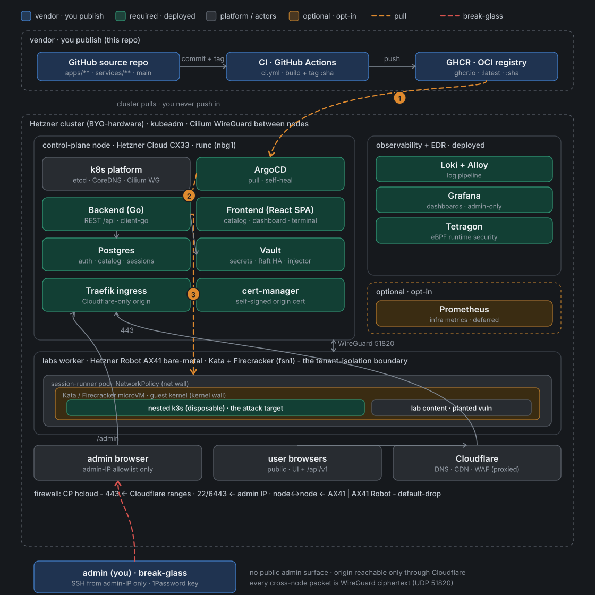
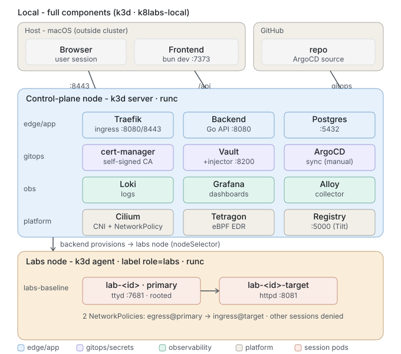
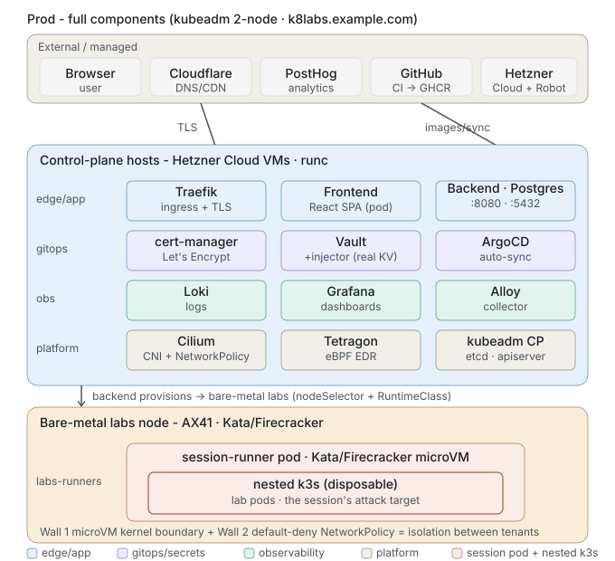

# Architecture

This directory documents how k8-labs is built: the technology picks, the
local-vs-prod split, the per-session isolation model, and the design and
rollout plans for the research labs. Start with the diagrams below for the big
picture, then follow the index for detail.

## Documents in this directory

| Doc | What it covers |
|---|---|
| [tech-stack.md](./tech-stack.md) | The language and framework picks behind `services/` and why each was chosen. |
| [environments.md](./environments.md) | Local vs prod: the value-by-value map of what differs between the two environments, and the two places it deliberately doesn't. |
| [nested-lab-rewrite.md](./nested-lab-rewrite.md) | The per-session disposable nested k3s cluster the Backend provisions inside a microVM on the labs node. |
| [lab-session-rewrite.md](./lab-session-rewrite.md) | Turning a lab session from two paragraphs and a terminal into a guided, click-through course with a scoped topology view. |
| [ebpf-per-session.md](./ebpf-per-session.md) | Design and rollout plan for per-session eBPF via a dedicated `kata-fc-ebpf` RuntimeClass and custom guest kernel. |
| [kasan-research-lab.md](./kasan-research-lab.md) | Design and rollout plan for the kernel driver research lab (KASAN guest kernel, in-guest UAF driver, Defender pane). |
| [research-driver-catalog.md](./research-driver-catalog.md) | Proposed spec for letting research users upload, vet, pick, and load their own compiled `.ko` drivers per session. |
| [alloy-config.river](./alloy-config.river) | The Grafana Alloy (River) config that ships every container's stdout to Loki. |
| [grafana-values.yaml](./grafana-values.yaml) | Local-dev Grafana Helm values (Loki datasource provisioning). |

For how to stand the platform up yourself, see the [self-hosting guide](../self-hosting.md).

## Prod architecture - one page

The trust-boundary / pull-model view: what publishes (repo → CI → GHCR), how the
cluster **pulls** (ArgoCD self-heal, never a push in), the two Hetzner nodes
(CX33 control plane, AX41 bare-metal labs worker), the per-session isolation
walls (NetworkPolicy → Kata/Firecracker microVM → disposable nested k3s), the
origin firewalls, and admin SSH as the only break-glass path. Colour = role
(publish / deployed / platform+actors / optional); orange dashed = pull; red
dashed = break-glass. Numbers: ① GHCR→ArgoCD image+manifest pull, ② ArgoCD
self-heal onto the app, ③ Backend provisions a session-runner on the labs node.

## Component diagrams

The platform is deliberately **two environments** - a control plane and a labs
tier - and the component inventory is the *same* in both; only the substrate
underneath differs (see [environments.md](./environments.md) for the full
local-vs-prod value-by-value map). So there are two diagrams, not one:

### Local (as built)

One `k3d` cluster, two nodes. The **control-plane node** (runc) runs the app
(Traefik, Backend, Postgres), GitOps + secrets (cert-manager, Vault + Agent
Injector, ArgoCD), observability (Loki, Grafana, Alloy), and runtime + EDR
(Cilium, Tetragon). The **labs node** (a `k3d` agent labelled
`k8labs.io/role=labs`) is where the Backend provisions each session's pods via
`nodeSelector`. The Frontend runs as a host `bun dev` process (not a pod), and
images come from the local registry via Tilt. Everything here is verified
running; see the environments doc for the exact `k3d`/Helm/Tilt commands.

### Production (as built)

Same components, different substrate. The **control-plane host** (Hetzner Cloud
CX33) runs the identical platform stack; the Frontend becomes a real pod; images
come from **GHCR** (built by CI) and ArgoCD auto-syncs; TLS is real (Traefik +
Let's Encrypt). The **bare-metal labs node** (AX41) runs the same per-session
pods, but each is wrapped in a **Kata/Firecracker microVM** - the one thing
local can't reproduce, and the actual isolation boundary between tenants.
External/managed: Cloudflare (DNS/CDN), PostHog (analytics), GitHub
(repo/CI/GHCR), Hetzner (Cloud CP + Robot AX41).

*Prod is **live** as a hand-built 2-node kubeadm cluster (Path B in
[infra/cluster/kubeadm-2node.md](../../infra/cluster/kubeadm-2node.md)), not the
CAPH bootstrap the earlier plan targeted (CAPH was never pivoted in). Cloudflare
is wired (origin 80/443 restricted to its edge); PostHog is still documented
intent, not yet wired. See the [self-hosting guide](../self-hosting.md) for the
deployed nodes, networking, and firewalls.*

### The per-session lab unit (both environments)

Each session is a **session-runner pod** that boots a throwaway k3s cluster, and
the lab is a bundle of manifests applied *into* that cluster - so winning a lab
compromises only the disposable nested cluster. See
[nested-lab-rewrite.md](./nested-lab-rewrite.md) for the model and
`services/labs/_template/README.md` for how a module is authored. Locally the
runner is plain privileged `runc`; in prod the `RuntimeClass=kata-fc` seam (one
config field, `internal/labs/config.go`) wraps it in a microVM - that field is
the entire difference.

The older shape - a primary lab pod plus an optional lateral-movement target,
both in the outer cluster behind per-session NetworkPolicies - was removed; see
[lab-session-rewrite.md](./lab-session-rewrite.md), F1.

Scaling triggers (add capacity only when these are hit, not preemptively):

| Trigger | Add |
|---|---|
| Real uptime SLA | 2 more control-plane hosts (Cloud VMs) for HA |
| Concurrent sessions near one box's capacity | A second bare-metal labs node |
| Cross-node detection scenario needed | Multi-node lab tier |
| Recurring operational incidents | Prometheus (metrics) - logging via Loki is already in place, since session pods are deleted on TTL expiry and their logs would otherwise be lost for good |
| Deploy frequency/team size outgrows manual apply | Tighter ArgoCD auto-sync policy |
| Manual Vault unseal becomes disruptive | Auto-unseal via an external KMS |
